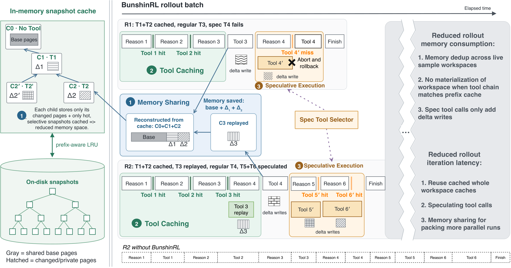

# ForkRL: Whole-Workspace Forking for Agentic RL Rollouts

ForkRL is an agentic reinforcement learning (RL) rollout system for computer-use and web agents. Agentic RL rollouts
interleave model reasoning with tool calls in persistent workspaces: running many of them at once costs memory for
every concurrent environment, and slow tool calls hold up whole rollout batches. ForkRL exploits the state that
environments share and the tool calls that recur, with three techniques built on live whole-workspace forking of
containers (tfork, from [os4agent](https://github.com/WukLab/os4agent)):

- **Memory sharing** (`--system tfork`): a GRPO group sets up its task's workspace once and forks it into live copies
  that share memory copy-on-write.
- **Tool-prefix caching** (`--tree-cache`, `--prefix-cache`, `--screen-cache`): rollouts and epochs that repeat a prefix
  of tool calls skip it, from workspace snapshots kept in memory or on disk, and fork a writable branch at the first
  miss.
- **Speculative tool execution** (`--spec-exec`): while the model reasons, a predictor guesses the next tool calls and
  a forked copy runs them; a match is adopted, a miss is discarded.

Please find more details in our [paper](https://arxiv.org/abs/2611.10453) and
[blog post](https://mlsys.wuklab.io/posts/bunshinrl/).



## Components

| | |
|---|---|
| `core/` | rollout runner (`main.py`), sandboxes (`systems.py`), speculation (`toolspec/`, `spec_exec.py`), prefix caches (`prefix_tree.py`), GRPO (`loop.py`, `train_grpo.py`, `merge_lora.py`) |
| `envs/osworld/`, `envs/webarena/` | environment adapters (`env.py`), agents, task batches, uv projects, `run.sh` |
| `setup/` | tfork build, podman config, WebArena image, GPU-host model server |
| `os4agent/` | submodule: the tfork stack ([WukLab/os4agent](https://github.com/WukLab/os4agent)) |

## Setup

```bash
git clone --recursive https://github.com/WukLab/ForkRL.git && cd ForkRL
bash setup/build_tfork.sh                    # also sets sysctls; after a reboot, rerun it
export STORAGE_CONF=<storage.conf of a podman store with driver = "btrfs">
bash setup/make_containers_conf.sh
uv sync --frozen --project envs/osworld
uv sync --frozen --project envs/webarena
sudo envs/webarena/.venv/bin/python -I -m nltk.downloader -d /root/nltk_data punkt_tab
# with Docker installed, let podman's bridge through
sudo iptables -I DOCKER-USER -i podman0 -j ACCEPT
sudo iptables -I DOCKER-USER -o podman0 -m conntrack --ctstate RELATED,ESTABLISHED -j ACCEPT
```

**OSWorld:**

```bash
git clone https://github.com/xlang-ai/OSWorld && git -C OSWorld checkout 1a572e62
sudo env CONTAINERS_STORAGE_CONF=$STORAGE_CONF CONTAINERS_CONF=$PWD/containers-os4agent.conf \
    os4agent/podman-tfork.sh pull ghcr.io/wuklab/webtop:ubuntu-kde-osworld    # or build os4agent/ubuntu-img/kde
```

**WebArena** (load WebArena's `shopping_final_0712` image into Docker first,
[instructions](https://github.com/web-arena-x/webarena/tree/main/environment_docker)):

```bash
docker build -t wa-shop-orig-browser:latest setup/image
bash setup/build_chromium_bundle.sh
bash setup/build_image_chr142.sh
```

**Policy server** (vLLM on a GPU host; agents call `$LLM_URL`, default `http://127.0.0.1:8100/v1`):

```bash
scp setup/pod_serve.sh setup/vllm_ctl.sh root@<gpu-host>:/root/
ssh root@<gpu-host> mkdir -p /root/forkrl && scp core/train_grpo.py core/merge_lora.py root@<gpu-host>:/root/forkrl/
ssh root@<gpu-host> bash /root/pod_serve.sh  # GPU_UTIL=0.4 when training on the same GPU
ssh -N -L 8100:127.0.0.1:8000 root@<gpu-host> &
```

## Running

`envs/<env>/run.sh` runs `core/main.py` as root; `--help` lists every option.

```bash
bash envs/osworld/run.sh --system tfork --result-dir traces/osw             # --system tfork | criu | none
bash envs/osworld/run.sh --system tfork --replay traces/osw --result-dir traces/osw_replay   # replay, no model
bash envs/osworld/run.sh --system tfork --spec tage --spec-exec 1 --spec-prefork 1 --result-dir traces/osw_spec
bash envs/osworld/run.sh --system tfork --tree-cache traces/tree --result-dir traces/osw_tree
bash envs/webarena/run.sh --system tfork --result-dir traces/wa
```

GRPO (rollouts here, LoRA updates on the GPU host):

```bash
envs/osworld/.venv/bin/python -I core/loop.py --env osworld --exp grpo1 --system tfork --epochs 4 --pod root@<gpu-host>
```
